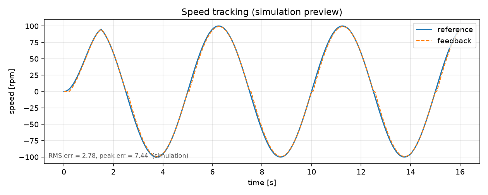
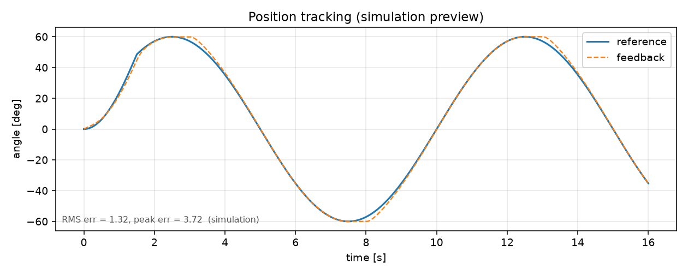
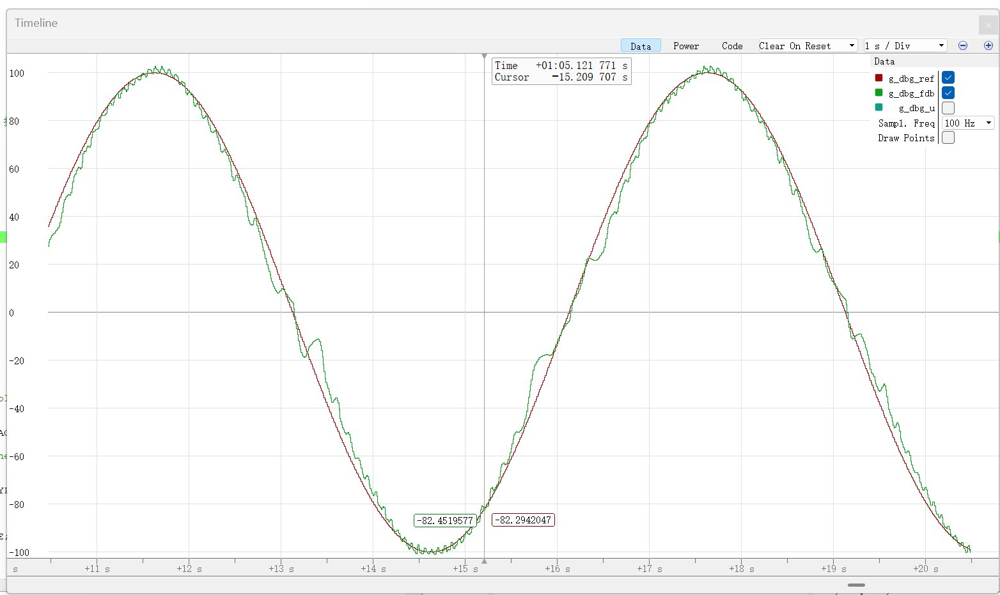
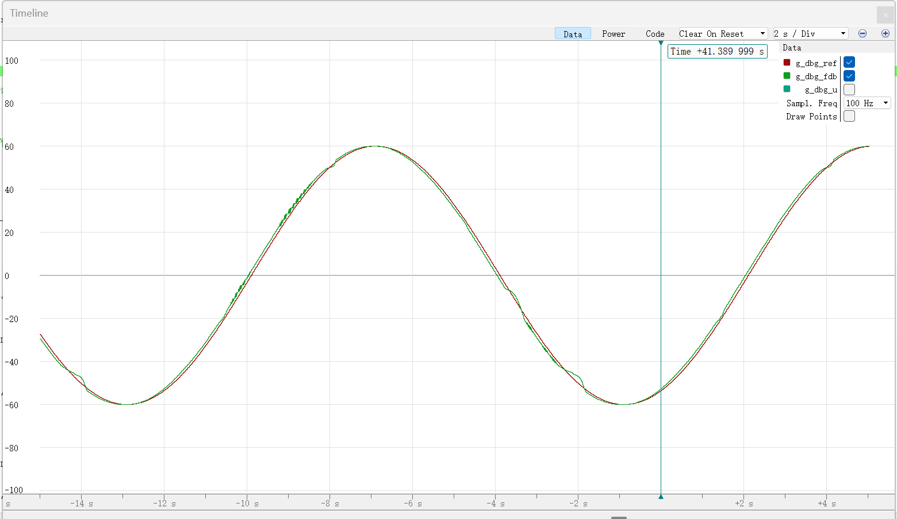

# GM6020 正弦跟随（RoboMaster 电控第一阶段考核）

用 RoboMaster 开发板 C 型驱动一台 GM6020 电机，分别跟随**正弦速度给定**与**正弦位置给定**，
并用独立看门狗（IWDG）做运行保护。

> 到基地现场的操作顺序见 [CHECKLIST.md](CHECKLIST.md)。

- 控制频率：1 kHz（TIM6）
- 通信：CAN1 @ 1 Mbps（电压控制模式，`0x1FF` / 反馈 `0x205`）
- 上位机曲线：USART1 @ 256000，DMA 发送，每 2 ms 一帧 `ref,fdb`
- 看门狗：IWDG 64 分频 / 400 重装 ≈ **0.8 s**

## 一、控制方案

### 1. 速度环（`kModeSpeed`）

```
ω_ref(t) = A_ω · sin(2π f_ω t)          A_ω = 100 rpm, f_ω = 0.2 Hz
u        = K_ff · ω_ref                 K_ff = 2.5 电流单位/rpm   （速度前馈，主量）
         + F_fric(ω_ref)                摩擦前馈：低速 500，高速 60，按速度衰减
         + Kp·e + Ki·∫e + Kd·de/dt      e = ω_ref − ω_fb（反馈先过一阶低通）
```

最终参数：`Kp = 20`、`Ki = 2`、`Kd = 1`、`K_ff = 2.5`、反馈低通 `α = 0.012`（约 83 ms）。

**这台电机工作在电流控制模式。** 它被 RoboMaster Assistant 设成了电流模式，
只认 `0x1FE` 电流帧（`16384 = 3 A`），`0x1FF` 电压帧会被直接忽略——实测下发
`15000`（约 14.4 V）时反馈电流仍是 0、电机不转；换成 `0x1FE` 立刻有响应。

电流模式下"电流 → 转矩 → 角加速度"，被控对象近似一个积分环节，所以整定思路和电压模式
完全不同，最后收敛到的结论是：

| 手段 | 为什么这么给 |
|---|---|
| **Kp 给得很高（20）** | 误差一出现立刻出电流，误差攒不起来，积分也就没有过冲的"燃料" |
| **Ki 几乎为 0（2）** | 积分是过冲的主因：最初 `Ki=45` 时过零后冲过头，降到个位数后消失 |
| **摩擦前馈单独给** | 给定过零时 `K_ff·ω_ref` 也趋零，破不了静摩擦，必须额外顶一把 |
| **反馈一阶低通** | GM6020 是 10 对极，100 rpm 时本身有 16.7 Hz 齿槽脉动，不滤会带着 PID 一起抖 |

### 2. 位置环（`kModePosition`）

```
θ_ref(t) = θ_0 + A_θ · sin(2π f_θ t)           A_θ = 60°, f_θ = 0.1 Hz
ω_ref    = dθ_ref/dt + Kp_θ·(θ_ref − θ_fb)     位置外环（Kp_θ = 15），输出速度给定
u        = K_ff·ω_ref + F_fric(ω_ref) + 速度环  速度内环，输出电流给定
```

- `θ_0` 取进入位置模式瞬间的角度，所以给定从 0 开始，上电不会突然甩一下。
- `dθ_ref/dt` 是位置给定的微分前馈，用来抵消“先有误差再动作”的相位滞后。
- 位置环输出限幅 ±20 rad/s，电流环输出限幅 ±3000（约 0.55 A），都留了安全余量。

### 3. 起振渐变

前 1.5 s 幅值从 0 线性升到满幅（`kRampInSec`），避免第一拍就满幅给定导致冲击。

### 4. 实测结果

| 项目 | 指标 |
|---|---|
| 速度环 | ±100 rpm / 0.2 Hz，峰顶与给定重合；过零附近有 10~15 rpm 的粘滑偏差 |
| 位置环 | ±60° / 0.1 Hz，几乎完全重合，仅最陡处有轻微相位滞后 |
| CAN | 1 kHz 稳定收帧，ESR 全程 0 错误 |

曲线由 Ozone 的 Timeline 采集（`g_dbg_ref` / `g_dbg_fdb`，100 Hz 采样），见文末截图。

## 二、看门狗保护

`.ioc` 里 IWDG 默认使能：LSI 32 kHz ÷ 64 分频 = 500 Hz 计数，重装值 400
→ 超时时间 `400 / 500 = 0.8 s`。

喂狗策略（`ControlTaskLoop`，主循环里调用）：

```c
if (g_task_tick != s_fed) {     // 1 kHz 任务心跳有推进
    s_fed = g_task_tick;
    HAL_IWDG_Refresh(&hiwdg);
}
```

即**只有 1 kHz 控制任务还活着，主循环才喂狗**。若控制任务卡死（死循环、HardFault 后
中断被关掉等），心跳不再推进，0.8 s 后芯片自动复位，电机输出随之清零。

另外两层保护：

- **CAN 掉线**：超过 100 ms 没有收到 `0x205` 反馈，输出直接置 0，红灯 2 Hz 闪。
- **长按 KEY（>1.5 s）**：先把电压写 0，再进入死循环并关中断，用来现场演示看门狗复位。

> 调试注意：`ControlTaskInit()` 里调用了 `__HAL_DBGMCU_FREEZE_IWDG()`，
> 挂调试器单步时看门狗会暂停，不会因为断点停久了把板子重启掉。

## 三、硬件接线

| 开发板 C 型 | 接到 | 说明 |
|---|---|---|
| CAN1（2-pin） | GM6020 CAN 口 | 板端 pin1 = CANL，pin2 = CANH；电机线 A 红 = CANH，B 黑 = CANL，**别接反** |
| UART（4-pin，丝印 UART2） | USB-TTL 模块 | 板端 1=RXD 2=TXD 3=GND 4=5V；TTL 的 TX 接板 RXD |
| SWD（4-pin） | ST-Link / J-Link | 3.3V / SWDIO / SWCLK / GND |
| 24V 输入 XT30 | 24 V 电源 | GM6020 也从 24 V 取电，建议单独一路或确认线径够 |

注意两点：

1. 外壳丝印和实际串口是**反的**：丝印 `UART2` 的 4-pin 口才是 STM32 的 USART1（PA9/PB7），
   本工程用这个口；丝印 `UART1` 的 3-pin 口是 USART6。
2. 电机拨码开关前三位是 ID：`001` → ID=1，对应反馈帧 `0x205`。若你的电机不是 ID=1，
   改 `Tasks/ControlTask.cpp` 里的 `cfg::kMotorId`。
   第四位是 120 Ω 终端电阻，单电机短距离测试建议拨到 ON。

## 四、编译与烧录

环境：CMake ≥ 3.22、Ninja、`arm-none-eabi-gcc`、STM32CubeMX 6.x（仅改外设时才需要）。

```bash
cmake --preset Debug
cmake --build --preset Debug
```

产物：`build/gm6020_sine.elf`。

烧录（OpenOCD，按你的下载器选 interface）：

```bash
# ST-Link
openocd -f interface/stlink.cfg -f target/stm32f4x.cfg \
  -c "program build/gm6020_sine.elf verify reset exit"

# J-Link
openocd -f interface/jlink.cfg -f target/stm32f4x.cfg \
  -c "program build/gm6020_sine.elf verify reset exit"

# CMSIS-DAP (DAP-Link)
openocd -f interface/cmsis-dap.cfg -f target/stm32f4x.cfg \
  -c "program build/gm6020_sine.elf verify reset exit"
```

也可以用仓库里的脚本：`tools\flash.cmd`（默认 J-Link，
换下载器就加 `-Interface stlink` 或 `-Interface cmsis-dap`；它内部用 `-ExecutionPolicy Bypass` 绕过执行策略）。

## 五、上位机曲线与截图

出图有两条路，任选其一（都很适合交作业，Ozone 那条不需要额外硬件）。

### 方式 A：Ozone 的 Timeline（基地常用，只靠 J-Link）

代码里专门留了 4 个全局变量给调试器看，它们用 `extern "C"` + `volatile` 声明，
符号名干净、不会被优化掉（定义在 `Tasks/ControlTask.cpp` 顶部）：

| 变量 | 含义 | 单位 |
|---|---|---|
| `g_dbg_ref` | 当前给定 | 速度模式 rpm / 位置模式 度 |
| `g_dbg_fdb` | 当前反馈 | 同上 |
| `g_dbg_u` | 当前输出电压给定 | -25000 ~ 25000 |
| `g_dbg_mode` | 0 = 速度模式，1 = 位置模式 | — |

操作顺序：

1. Ozone → `File → Open`，选 `build/gm6020_sine.elf`；Device 选 `STM32F407IG`，Interface 选 J-Link
2. `Download & Run` 烧录并全速运行（不要停住，停住就没有数据）
3. 打开 `View → Timeline`，把 `g_dbg_ref`、`g_dbg_fdb` 拖进去（想看控制量再加 `g_dbg_u`）
4. 采样周期设 **10 ms** 左右——信号是 0.2 Hz，10 ms 采一个点一个周期还有 500 点，够用
5. 跑 15~20 s 截一张（速度环），短按板载 KEY 切到位置模式（蓝灯）再截一张

### 方式 B：串口 + Python 脚本（需要 USB-TTL）

固件在 USART1 上每 2 ms 发一行 ASCII：`ref,fdb\r\n`

- 速度模式：单位 rpm
- 位置模式：单位 度（相对进入位置模式时的角度）

```bash
pip install pyserial matplotlib

# 先确认串口有数据
python tools/plot_live.py --port COM5 --print-only

# 采集 25 s 并截图
python tools/plot_live.py --port COM5 --mode speed    --seconds 25 --out figures/speed_follow.png
python tools/plot_live.py --port COM5 --mode position --seconds 35 --out figures/position_follow.png
```

串口助手（VOFA+ / SerialPlot）也能直接看，选择 `256000, 8N1`，
两通道 CSV 即可。

> 两条路用的是同一个 `g_dbg_*` 数据源，Ozone 那条不依赖串口，所以基地没有
> USB-TTL 也能出图。

## 六、板载指示

| 现象 | 含义 |
|---|---|
| 绿灯常亮 | 速度模式，CAN 正常 |
| 蓝灯常亮 | 位置模式，CAN 正常 |
| 红灯 2 Hz 闪 | 超过 100 ms 没收到电机反馈（CAN 没通 / ID 不对 / 电机没上电） |
| 灯全灭后 0.8 s 重启 | 触发了长按 KEY 的看门狗演示 |
| 电机橙灯常亮 | 电机被设成了电流控制模式，需要用 RoboMaster Assistant 改回电压模式 |

短按 KEY（< 1 s）在速度/位置模式之间切换。

## 七、调参步骤（到基地后照这个顺序做）

1. **先看反馈对不对**：`--print-only`，用手转电机，第一列不动、第二列（速度）跟着变，
   说明 CAN 通了。若两列都是 0 且红灯闪 → 查 ID、CANH/CANL、电机供电。
2. **速度环**：从 `kSpdKp=25, kSpdKi=150` 开始。曲线整体“慢半拍” → 加大 `kSpdKp`；
   顶部削平/抖动 → 减小 `kSpdKp`；零速附近有台阶（摩擦力）→ 加大 `kSpdKi`。
   前馈 `kVoltPerRpm` 基本不用动。
3. **位置环**：`kPosKp=8` 起步。曲线整体滞后 → 加大 `kPosKp`；
   过零处来回抖 → 减 `kPosKp` 或加 `kPosKd=0.02~0.05`；
   顶点附近“顶不上去” → 给位置环加一点 `kPosKi=1~3`。
4. 每改一次参数重新 `cmake --build --preset Debug` 并烧录，采集一次截图。

## 八、踩坑记录（都是"不接电机就看不出来"的）

1. **电机是电流控制模式**：下发 `0x1FF` 电压帧时反馈电流恒为 0、电机不转。
   改成 `0x1FE` 电流帧后立刻正常。判断方法：给电压帧时看反馈电流，若恒 0 就是驱动
   忽略了电压指令（或电机被 Assistant 设成了电流环）。
2. **USART3 / USART6 中断风暴**：CubeMX 打开了这两个串口的中断，但工程只用 USART1。
   引脚悬空时溢出中断以优先级 0 疯狂触发，抢占 1 kHz 控制任务，主循环被饿死、
   看门狗反复复位。解决：初始化里 `HAL_NVIC_DisableIRQ(USART3_IRQn/USART6_IRQn)`。
3. **CAN 进 bus-off 后不自恢复**：`AutoBusOff` 默认 `DISABLE`，电机未上电时没人给 ACK，
   累加到 bus-off 就永久躺平，电机上电也通不了。解决：`hcan1.Init.AutoBusOff = ENABLE`。

## 九、目录结构

```
Tasks/ControlTask.cpp      1 kHz 调度、速度/位置环、串口上报、喂狗
Tasks/Gm6020.cpp           GM6020 CAN 协议（角度多圈累计、电压下发）
Tasks/Pid.cpp              位置式 PID（条件积分抗饱和 + 微分低通）
Tasks/*.h                  对应头文件
Core/                      CubeMX 生成：main.c / can.c / tim.c / usart.c / iwdg.c ...
tools/plot_live.py         串口实时曲线 + 截图
tools/sim_control.py       离线闭环仿真（验证参数方向）
tools/flash.ps1            一键编译 + 烧录（PowerShell 版）
tools/flash.cmd            同上，双击/直接运行的包装器
figures/                   曲线图
```

手写代码全部放在 `Tasks/`，`Core/` 保持"CubeMX 专属"——重新生成代码不会碰到 `Tasks/`。

构建用的是组里的 CMake 模板：它用 `GLOB_RECURSE` 自动收集 `Core/` 和 `Tasks/` 下的源文件，
所以**新增 .c/.cpp 不需要改 CMakeLists**，放进这两个目录即可（所在目录会自动加入 include 路径）。
但要注意 glob 是在**配置期**展开的：新增或删除了源码文件，必须重新跑一次 `cmake --preset Debug`
（或删掉 `build/` 重新配置），否则新文件不会参与编译。

## 十、离线仿真预览（非实测）

没有硬件时用 `tools/sim_control.py` 按同一套控制律跑一阶+摩擦模型，
用来确认增益方向与限幅，结果仅作参考：




## 十一、实测截图

Ozone Timeline 采集，横轴时间、红=给定、绿=实际反馈。

**速度跟随**（±100 rpm / 0.2 Hz，绿灯 = 速度模式）：



**位置跟随**（±60° / 0.1 Hz，蓝灯 = 位置模式）：


